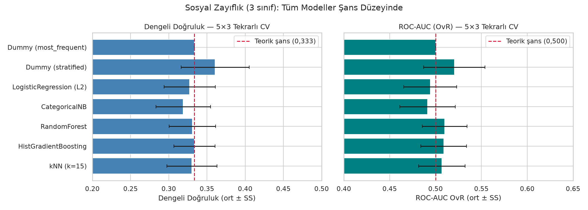
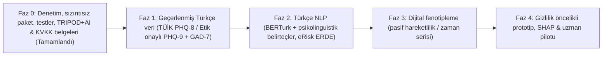

# Mental Pulse

**Ruh sağlığı ve depresif belirti taraması için bilimsel literatüre dayalı, sızıntısız, açıklanabilir ve yeniden üretilebilir araştırma deposu**

> [!CAUTION]
> **Tıbbi Uyarı:** Bu depodaki kod, analizler ve ölçek puanlayıcılar **tıbbi tanı veya tedavi aracı değildir**; yalnızca bilimsel araştırma ve eğitim amaçlıdır. Kendinize zarar verme düşünceniz veya acil bir ruh sağlığı kriziniz varsa Türkiye'de **112 Acil Çağrı Merkezi**'ni veya **ALO 183 Sosyal Destek Hattı**'nı arayabilir ya da en yakın sağlık kuruluşuna başvurabilirsiniz.

---

## 1. Proje Özeti

**Mental Pulse**, depresif belirtilerin erken taranması ve ruh sağlığı verilerinin makine öğrenmesi ile incelenmesi amacıyla başlatılmıştır. Proje; orijinal anket analizinin (`mentalHealth/analiz.ipynb`) baştan sona denetlenmesi, 40+ hakemli bilimsel makalenin taranması ve elde edilen çıkarımlar doğrultusunda **modüler Python paketi (`src/mental_pulse/`)**, **yeniden üretilebilir analiz defteri (`mentalHealth/analiz_v2.ipynb`)**, **birim testleri (`tests/`)** ve **TRIPOD+AI / Datasheets for Datasets / KVKK uyumlu bilimsel dokümantasyon (`docs/`)** ile baştan yapılandırılmıştır.

### Temel Bilimsel Bulgular (Özet)

1. **Veri kaynağı izlendi (CC BY 4.0 atfı eklendi):** Depodaki 824 × 13 boyutlu anket verisi, Bangladeş'te COVID-19 karantinası döneminde toplandığı bildirilen **RHMCD-20** veri setidir (Salehin & Amin, 2023, Mendeley Data DOI: [`10.17632/pxjmjyfdh2.2`](https://doi.org/10.17632/pxjmjyfdh2.2); Amin vd., 2024, *Data in Brief* 54:110376).
2. **Orijinal koddaki kritik hatalar tespit edildi ve yeniden üretildi:**
   - **H1 (Kritik):** `analiz.ipynb` hücre 21–23'te `X_train_resampled` değişkeni önce erkek, ardından kadın verisiyle **üzerine yazıldığı** için "Erkek" modelleri aslında **kadın eğitim verisiyle** eğitilmiştir.
   - **H2 (Kritik):** Taban çizgisi (`DummyClassifier`) ve çapraz doğrulama yoktur; erkek test kümesinde en sık sınıf oranı zaten **%41** iken raporlanan %34–44 doğruluk yanıltıcıdır.
   - **H3–H11:** Alfabetik `LabelEncoder` + Pearson korelasyonu, sabit `Cinsiyet` sütunu, kayıp hücre 12, dengeli sınıflarda gereksiz SMOTE, pandas ≥ 3 kırılması, Windows yol ayırıcıları ve "Tahmin" olarak yanlış etiketlenmiş ağırlıklı kesinlik (`precision`).
3. **Veride öğrenilebilir sinyal yok:** Bağımsız kalite denetiminde **13/13 sütun tekdüze dağılımdan ayırt edilememekte** ($p \ge 0,05$), 78 değişken çiftinde **en yüksek Cramér's V = 0,068** (BH-FDR sonrası anlamlı çift: **0**), **89 satırda `Male + Housewife`** gibi mantıksal tutarsızlıklar ve makale–CSV arasında 4 sütunda kategori uyumsuzluğu bulunmaktadır.
4. **Sızıntısız değerlendirme sonucu:** 5×5 tekrarlı tabakalı çapraz doğrulama ve 200 tekrarlı permütasyon testinde 7 farklı sınıflandırıcı, tüm hedef değişkenlerde (`Social_Weakness`, `Growing_Stress`, `Mood_Swings`, `Coping_Struggles`) **şans düzeyindedir** (ROC-AUC ≈ 0,50, permütasyon $p > 0,48$).
5. **Bilimsel yol haritası oluşturuldu:** Literatür (WHO 2026; Lancet 2021; Yıldız vd. 2024; Kroenke vd. 2001; De Choudhury vd. 2013; Al-Mosaiwi & Johnstone 2018; Eichstaedt vd. 2018; Saeb vd. 2015; Kapoor & Narayanan 2023; Collins vd. 2024) doğrultusunda, **PHQ-9 / GAD-7 + Türkçe psikolinguistik özellik çıkarımı** çekirdeği (`src/mental_pulse/screening.py`) yazılmış ve 4 fazlı yeni araştırma mimarisi tanımlanmıştır.

---

## 2. Depo Yapısı

```text
Mental-Pulse/
├── README.md                          # Proje genel bakış, kurulum, CLI ve bulgular
├── pyproject.toml                     # Paketleme (setuptools) ve pytest yapılandırması
├── .github/workflows/ci.yml           # GitHub Actions CI (Python 3.11 & 3.12, pytest + CLI duman testleri)
├── src/mental_pulse/                  # Modüler, testli Python paketi
│   ├── data.py                        # RHMCD-20 yükleyici, şema ve 4'lü kalite denetimi
│   ├── stats.py                       # Yanlılık düzeltmeli Cramér's V, BH-FDR, literatür hipotezleri
│   ├── modeling.py                    # Sızıntısız Pipeline CV, permütasyon, adalet (fairness), H1 repro
│   ├── screening.py                   # PHQ-9 / GAD-7 puanlayıcı + Madde 9 kriz bayrağı + Türkçe NLP özellikleri
│   ├── temporal.py                    # CLEF eRisk ERDE / F_latency + dijital fenotipleme zaman serisi özellikleri
│   ├── fusion.py                      # Faz 1–3 kişi-bazlı (StratifiedGroupKFold) çok kipli boru hattı + Riley (2020) örneklem hesabı
│   └── cli.py                         # `mental-pulse` komut satırı arayüzü
├── scripts/
│   └── train_berturk_template.py      # Faz 2 GPU BERTurk ince ayar şablonu (kişi-bazlı CV, TRIPOD+AI)
├── tests/                             # 21 birim testi (pytest)
│   ├── test_data_and_stats.py
│   ├── test_modeling.py
│   ├── test_screening.py
│   └── test_temporal_and_fusion.py
├── mentalHealth/
│   ├── analiz_v2.ipynb                # Yeniden üretilebilir, sızıntısız analiz defteri (yeni)
│   ├── analiz.ipynb                   # Orijinal defter (arşiv / karşılaştırma için korunmuştur)
│   ├── data.csv                       # RHMCD-20 (İngilizce, 824×13, CC BY 4.0)
│   ├── dataTR.csv                     # RHMCD-20 Türkçe etiketli kopya
│   ├── requirements.txt               # Güncellenmiş sürümlü bağımlılıklar
│   └── ciktilar/
│       └── v2/                        # analiz_v2.ipynb tarafından üretilen 6 yüksek çözünürlüklü grafik
└── docs/                              # Bilimsel rapor ve standart belgeleri
    ├── ARASTIRMA_RAPORU.md            # 16 bölümlü kapsamlı araştırma raporu (41 kaynak)
    ├── LITERATUR_MATRISI.md           # 25+ temel makalenin karşılaştırmalı literatür matrisi
    ├── VERI_KARTI_RHMCD20.md          # Datasheets for Datasets (Gebru vd., 2021) veri kartı
    ├── TRIPOD_AI_KONTROL_LISTESI.md   # TRIPOD+AI (Collins vd., 2024, BMJ) 27 maddelik öz-değerlendirme
    ├── ETIK_VE_KVKK_CERCEVESI.md      # KVKK Md. 6, WHO (2021) YZ Etiği, kriz protokolü ve onam şablonu
    └── FAZ1_ANKET_VE_ETIK_BASVURU_PAKETI.md # Etik kurul taslağı, TÜİK mikro veri başvurusu, Türkçe anket şeması
```

---

## 3. Kurulum ve Hızlı Başlangıç

Python 3.10+ önerilir.

```bash
# 1) Sanal ortam oluştur ve etkinleştir
python3 -m venv .venv
source .venv/bin/activate   # Windows: .venv\Scripts\activate

# 2) Paketi geliştirme bağımlılıklarıyla kur
pip install -e ".[dev]"

# 3) Birim testlerini çalıştır (21 test)
pytest -v
```

### Komut Satırı Arayüzü (`mental-pulse`)

```bash
# RHMCD-20 veri kalitesi, Cramér's V + FDR ve literatür hipotez denetimi
mental-pulse audit

# Sızıntısız çapraz doğrulama, permütasyon testi, alt grup adaleti ve H1 hatası yeniden üretimi
mental-pulse benchmark --target Social_Weakness --fairness --repro-bug

# Türkçe metinden psikolinguistik özellik çıkarımı (Rude 2004; Al-Mosaiwi 2018; Eichstaedt 2018)
mental-pulse features "Ben her zaman kendimi çok yalnız ve umutsuz hissediyorum, hiçbir şey asla düzelmeyecek."

# PHQ-9 tarama puanlaması ve Madde 9 kriz protokolü testi (tıbbi tanı aracı değildir)
mental-pulse screen --scale phq9 --scores 2,2,1,2,1,1,1,0,1

# Riley vd. (2020, BMJ) klinik tahmin modeli minimum örneklem büyüklüğü hesabı
mental-pulse sample-size --prevalence 0.064 --parameters 15

# CLEF eRisk erken risk tespit hatası (ERDE_5, ERDE_50) ve F_latency hesabı
mental-pulse erde --y-true 1,1,0,0 --y-pred 1,1,0,0 --delays 3,15,5,5
```

### Analiz Defterini Yeniden Çalıştırma

```bash
cd mentalHealth
jupyter nbconvert --to notebook --execute --inplace analiz_v2.ipynb
```

---

## 4. Temel Deney Sonuçları (`Social_Weakness`, 3 Sınıf — 5×5 Tekrarlı CV)

| Model | Doğruluk | Dengeli Doğruluk | Makro-F1 | ROC-AUC (OvR) |
|---|---:|---:|---:|---:|
| Taban: en sık sınıf | 0,348 ± 0,003 | 0,333 | 0,172 | 0,500 |
| Taban: tabakalı rastgele | 0,328 ± 0,024 | 0,330 | 0,327 | 0,497 |
| Lojistik Regresyon (L2) | 0,334 ± 0,035 | 0,332 | 0,330 | 0,500 |
| Kategorik Naive Bayes | 0,326 ± 0,035 | 0,324 | 0,322 | 0,498 |
| Random Forest | 0,342 ± 0,034 | 0,340 | 0,336 | 0,515 |
| Hist. Gradient Boosting | 0,343 ± 0,033 | 0,342 | 0,340 | 0,516 |
| XGBoost | 0,353 ± 0,029 | 0,352 | 0,351 | 0,523 |
| SVM (RBF) | 0,347 ± 0,038 | 0,344 | 0,341 | 0,498 |
| k-NN (k=15) | 0,343 ± 0,033 | 0,339 | 0,332 | 0,512 |

*Permütasyon testi (Lojistik Regresyon, 200 karıştırma): gözlenen dengeli doğruluk = 0,333, şans ortalaması = 0,335, **$p = 0,54$**.*



---

## 5. Önerilen Sistem Mimarisi ve Yol Haritası



- **Ayrıntılı araştırma raporu:** [`docs/ARASTIRMA_RAPORU.md`](docs/ARASTIRMA_RAPORU.md)
- **Literatür matrisi (25+ makale):** [`docs/LITERATUR_MATRISI.md`](docs/LITERATUR_MATRISI.md)
- **RHMCD-20 veri kartı:** [`docs/VERI_KARTI_RHMCD20.md`](docs/VERI_KARTI_RHMCD20.md)
- **TRIPOD+AI kontrol listesi:** [`docs/TRIPOD_AI_KONTROL_LISTESI.md`](docs/TRIPOD_AI_KONTROL_LISTESI.md)
- **Etik, KVKK ve kriz protokolü:** [`docs/ETIK_VE_KVKK_CERCEVESI.md`](docs/ETIK_VE_KVKK_CERCEVESI.md)
- **Faz 1 etik kurul, TÜİK ve anket paketi:** [`docs/FAZ1_ANKET_VE_ETIK_BASVURU_PAKETI.md`](docs/FAZ1_ANKET_VE_ETIK_BASVURU_PAKETI.md)

---

## 6. Veri Atfı ve Lisans

- **RHMCD-20 Veri Seti (`mentalHealth/data.csv`):**
  Salehin, I., & Amin, N. (2023). *The RHMCD-20 datasets for Depression and Mental Health Data Analysis with Machine Learning* (V2). Mendeley Data. DOI: [10.17632/pxjmjyfdh2.2](https://doi.org/10.17632/pxjmjyfdh2.2) — Lisans: **CC BY 4.0**.
  Veri makalesi: Amin, N., Salehin, I., Baten, M. A., & Al Noman, R. (2024). *Data in Brief*, 54, 110376. DOI: [10.1016/j.dib.2024.110376](https://doi.org/10.1016/j.dib.2024.110376).
- **Depo kodu ve dokümantasyonu:** Bilimsel araştırma ve eğitim amaçlıdır. Veri toplama ve klinik uygulama adımları için [`docs/ETIK_VE_KVKK_CERCEVESI.md`](docs/ETIK_VE_KVKK_CERCEVESI.md) belgesine uyulması zorunludur.
