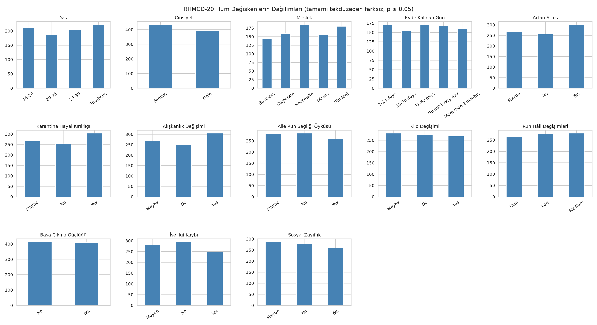
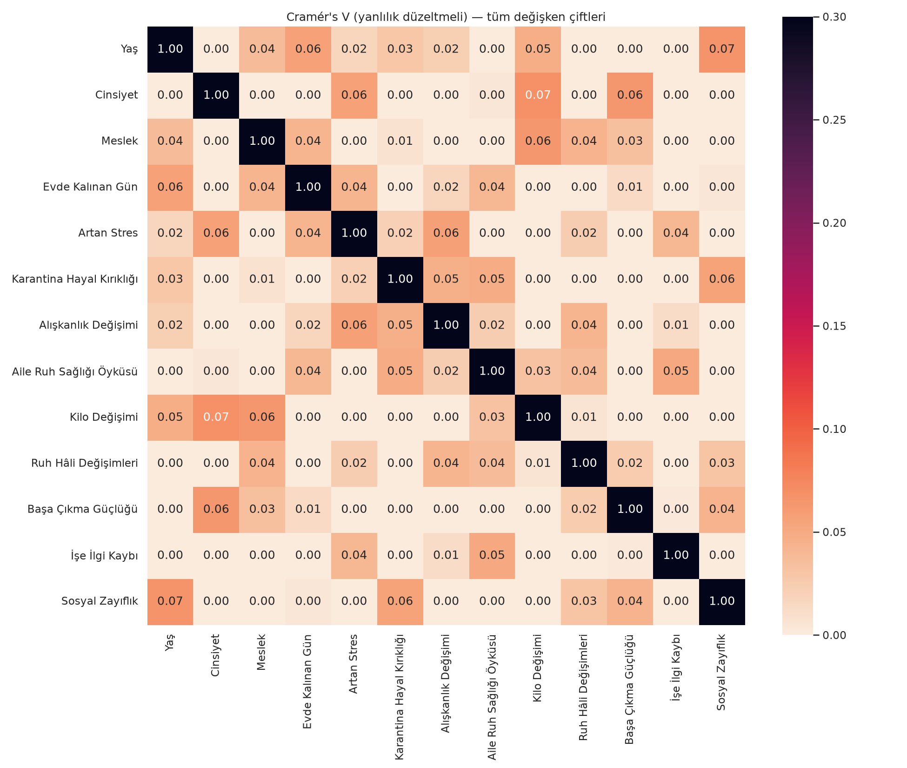
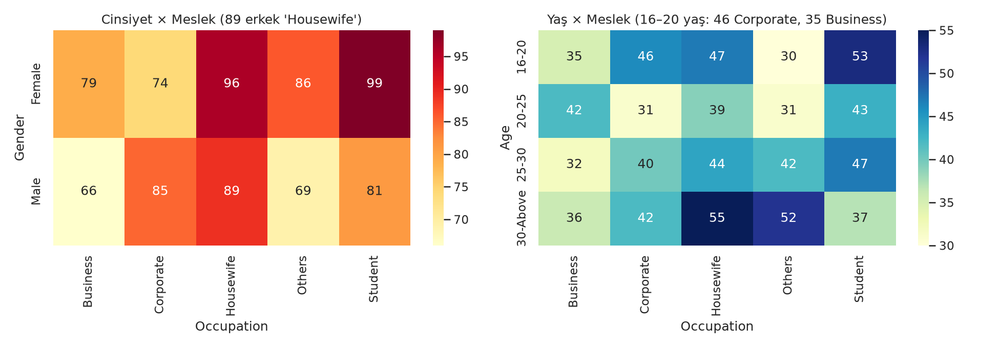
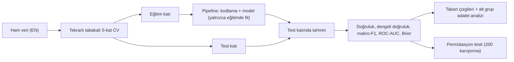
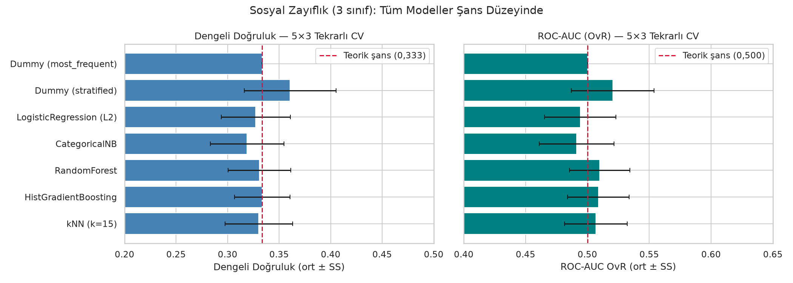
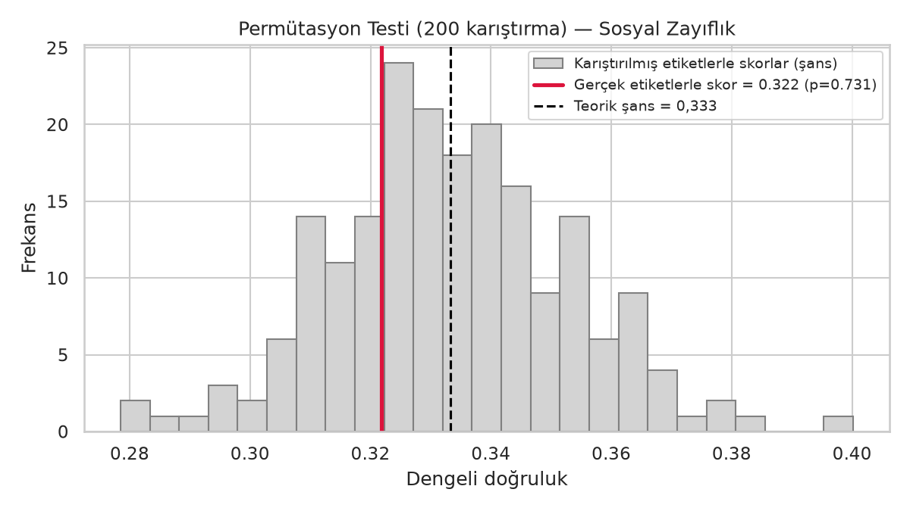
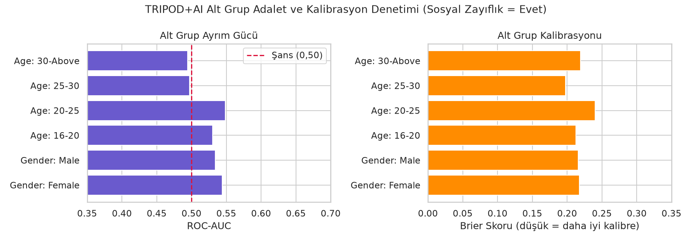
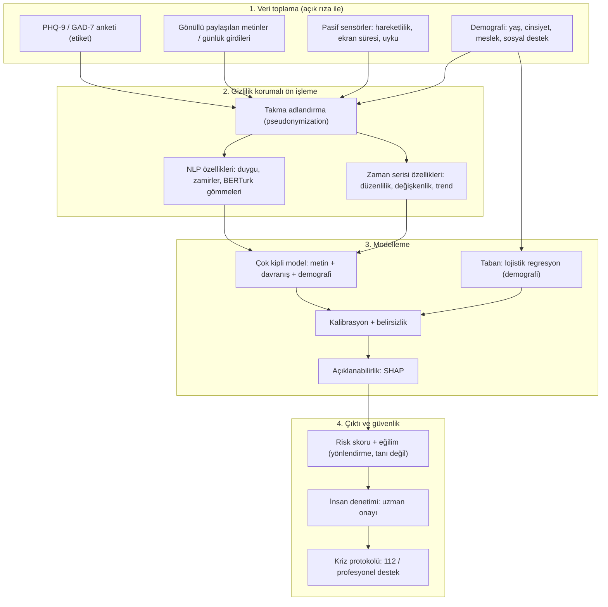
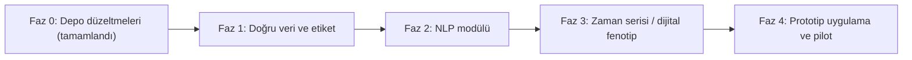

# Mental Pulse — Kapsamlı Araştırma ve Proje Detaylandırma Raporu

> **Kapsam:** Bu rapor, *Mental-Pulse* deposunun baştan sona incelenmesini, kullanılan veri setinin kaynağına kadar izlenmesini, analizlerin bağımsız olarak yeniden üretilmesini ve güncel bilimsel literatürün taranmasını içerir. Literatürden ve yeniden analizden çıkan sonuçlar projenin **hedeflerini, yöntemini, kısıtlarını, etik çerçevesini ve yol haritasını** ayrıntılandırmak için kullanılmıştır.
>
> İlgili dosyalar: [`mentalHealth/analiz_v2.ipynb`](../mentalHealth/analiz_v2.ipynb) (yeniden üretilebilir analiz) · [`mentalHealth/analiz.ipynb`](../mentalHealth/analiz.ipynb) (orijinal analiz) · [`README.md`](../README.md)

---

## İçindekiler

1. [Yönetici Özeti](#1-yönetici-özeti)
2. [Arka Plan ve Motivasyon](#2-arka-plan-ve-motivasyon)
3. [Projenin Mevcut Durumu](#3-projenin-mevcut-durumu)
4. [Veri Seti: RHMCD-20](#4-veri-seti-rhmcd-20)
5. [Keşifsel Veri Analizi Bulguları](#5-keşifsel-veri-analizi-bulguları)
6. [Orijinal Kodun Teknik İncelemesi](#6-orijinal-kodun-teknik-i̇ncelemesi)
7. [Düzeltilmiş Metodoloji ve Sonuçlar](#7-düzeltilmiş-metodoloji-ve-sonuçlar)
8. [Literatür Taraması](#8-literatür-taraması)
9. [Literatürdeki Boşluklar ve Projenin Konumlandırılması](#9-literatürdeki-boşluklar-ve-projenin-konumlandırılması)
10. [Önerilen Sistem Mimarisi](#10-önerilen-sistem-mimarisi)
11. [Yol Haritası](#11-yol-haritası)
12. [Değerlendirme Protokolü ve Başarı Ölçütleri](#12-değerlendirme-protokolü-ve-başarı-ölçütleri)
13. [Etik, Hukuk ve Güvenlik](#13-etik-hukuk-ve-güvenlik)
14. [Genişletilmiş Proje Kısıtları ve Risk Analizi](#14-genişletilmiş-proje-kısıtları-ve-risk-analizi)
15. [Sonuç](#15-sonuç)
16. [Kaynakça](#16-kaynakça)

---

## 1. Yönetici Özeti

| Konu | Bulgu |
|---|---|
| **Projenin iddiası** | Sosyal medya ve dijital etkileşim verileriyle depresyonun erken tespiti (README). |
| **Projenin gerçekte yaptığı** | 824 satırlık, tamamen kategorik bir COVID-19 karantina anketinde (RHMCD-20, Bangladeş) `Sosyal_zayiflik` değişkenini sınıflandırmak. Sosyal medya, NLP veya profil oluşturma bileşeni **yok**. |
| **Raporlanan sonuç** | %32–44 doğruluk (5 model, cinsiyete göre ayrılmış iki grup). |
| **Yeniden üretim** | Orijinal sayılar birebir yeniden üretildi; ancak *erkek* modellerinin bir kod hatası nedeniyle **kadın eğitim verisiyle** eğitildiği tespit edildi. |
| **Doğru değerlendirme** | Sızıntısız, 5×5 tekrarlı çapraz doğrulama + permütasyon testi: tüm modeller, tüm hedeflerde **şans düzeyinde** (ROC-AUC ≈ 0.50, p > 0.49). |
| **Kök neden** | Veride öğrenilebilir sinyal yok: 78 değişken çiftinin hiçbirinde Cramér's V ≥ 0.10 değil; FDR düzeltmesi sonrası anlamlı ilişki sayısı **0**. Dağılımlar tekdüze dağılımdan ayırt edilemiyor; mantıksal tutarsızlıklar var (ör. 89 erkek "ev hanımı"). |
| **Literatürle karşılaştırma** | Literatürde güçlü ve tutarlı olan ilişkiler (kadın cinsiyeti ↔ depresif belirti, uyku/beslenme değişimi ↔ kilo değişimi) bu veride görülmüyor. |
| **Öneri** | RHMCD-20'yi yalnızca "yöntem öğrenme / negatif kontrol" verisi olarak tutmak; asıl hedef için **geçerlenmiş ölçeklerle (PHQ-9/PHQ-8, GAD-7)** etiketlenmiş veriye ve README'de vaat edilen **metin (NLP) + dijital fenotipleme** yaklaşımına geçmek. |

---

## 2. Arka Plan ve Motivasyon

### 2.1 Küresel tablo

Dünya Sağlık Örgütü'nün (DSÖ) güncel bilgi notuna göre (WHO, 2026):

- 2023'te nüfusun yaklaşık **%4'ü**, yetişkinlerin **%5,2'si** depresyon yaşamaktadır (erkeklerde %4,1, kadınlarda %6,2); 70 yaş üstünde oran %5,4'tür.
- Dünyada yaklaşık **322 milyon** kişi depresyondadır; depresyon kadınlarda erkeklere göre yaklaşık **1,5 kat** daha yaygındır.
- 2021'de yaklaşık **727.000** kişi intihar nedeniyle yaşamını yitirmiştir; intihar 15–29 yaş grubunda **üçüncü** önde gelen ölüm nedenidir.
- Yüksek gelirli ülkelerde bile depresyonu olanların yalnızca yaklaşık **üçte biri** tedavi almaktadır.

Bu "tedavi açığı", **erken tespit** ve **ölçeklenebilir tarama** araçlarına olan ihtiyacı — yani Mental Pulse'ın varlık nedenini — doğrudan desteklemektedir.

### 2.2 COVID-19 pandemisinin etkisi

- *COVID-19 Mental Disorders Collaborators* (Lancet, 2021) 204 ülke için yaptığı modellemede, pandeminin 2020 yılında **majör depresif bozukluk vakalarını %27,6 (≈53,2 milyon ek vaka)**, **anksiyete bozukluklarını %25,6 (≈76,2 milyon ek vaka)** artırdığını tahmin etmiştir. Artış kadınlarda ve gençlerde daha belirgindir.
- Brooks ve ark. (Lancet, 2020) karantinanın psikolojik etkilerine dair hızlı derlemesinde (3166 makaleden 24'ü dahil) travma sonrası stres belirtileri, kafa karışıklığı ve öfke gibi olumsuz etkiler bildirmiş; **uzun karantina süresi, enfeksiyon korkusu, hayal kırıklığı (frustration), can sıkıntısı, yetersiz malzeme ve bilgi, maddi kayıp ve damgalanmayı** başlıca stres kaynakları olarak tanımlamıştır. RHMCD-20'deki `Days_Indoors` ve `Quarantine_Frustrations` değişkenleri doğrudan bu çerçeveye karşılık gelir.
- Prati ve Mancini (Psychological Medicine, 2021), 25 boylamsal çalışma ve doğal deneyin meta-analizinde kapanmaların ruh sağlığı belirtileri üzerindeki etkisinin **anlamlı fakat küçük** olduğunu ve **kapanma süresinin bu etkiyi anlamlı biçimde düzenlemediğini (moderate etmediğini)** göstermiştir. Bu bulgu, "evde kalınan gün sayısı" gibi tek bir değişkenden güçlü bir tahmin beklenmemesi gerektiğini öngörür.

### 2.3 Bangladeş bağlamı (veri setinin ülkesi)

Hosen, al-Mamun ve Mamun (Global Mental Health, 2021) Bangladeş'te pandemi dönemine ait 24 çalışmayı (49.806 katılımcı) meta-analizle birleştirmiş ve havuzlanmış yaygınlıkları **depresyon %47 (%95 GA 39–55)**, **anksiyete %47** ve **stres %44** olarak bulmuştur. Öğrencilerde depresyon yaygınlığı %65'e çıkmaktadır. **Cinsiyet, yaş, eğitim, gelir, fiziksel egzersiz, kronik hastalık ve sosyal medya maruziyeti** tutarlı risk etkenleridir. Ancak heterojenlik çok yüksektir (I² > %99) ve çalışmaların neredeyse tamamı çevrim içi, kolayda örneklemeli kesitsel anketlerdir.

### 2.4 Türkiye bağlamı (projenin hedef kitlesi)

Yıldız ve ark. (Türk Psikiyatri Dergisi, 2024), TÜİK **2019 Türkiye Sağlık Araştırması** mikro verisinde (17.084 kişi, ≥15 yaş) PHQ-8 ölçeğini kullanmıştır:

| Gösterge | Toplam | Kadın | Erkek |
|---|---|---|---|
| PHQ-8 ≥ 10 (klinik düzeyde depresif belirti) | **%6,4** | ~%8 | ~%4,7 |
| Hafif belirti (PHQ-8: 5–9) | %20,8 | %24,9 | %16,0 |
| "Son 12 ayda depresyon yaşadınız mı?" (öz-bildirim) | %10,1 | %13,2 | %6,1 |

Çok değişkenli analizde kadınlarda depresif belirti riski erkeklere göre **1,52 kat** yüksektir; yaş, düşük eğitim, fiziksel inaktivite, zayıf sosyal destek ve kronik hastalık risk etkenleridir. Ülkedeki son ulusal psikiyatrik epidemiyoloji çalışması (Erol ve ark., 1998) depresif nöbet yaygınlığını %4 (kadın %5,4, erkek %2,3) olarak bulmuştur.

> **Çıkarım:** Türkiye'de kullanılacak bir erken uyarı sistemi; PHQ-8/PHQ-9 gibi **Türkçe geçerliği gösterilmiş** ölçeklerle etiketlenmeli ve **cinsiyet, yaş, sosyal destek** gibi literatürde kanıtlanmış etkenleri modele dahil etmelidir.

---

## 3. Projenin Mevcut Durumu

### 3.1 Depo envanteri

| Dosya | İçerik | Not |
|---|---|---|
| `README.md` | Proje özeti, amaç, yöntem, kısıtlar, literatür taslağı | Sosyal medya/NLP vaat ediyor; kodla örtüşmüyor. |
| `mentalHealth/data.csv` | RHMCD-20 (İngilizce), 824 × 13 | Kaynak belirtilmemiş, lisans belirtilmemiş. |
| `mentalHealth/dataTR.csv` | Aynı verinin Türkçe etiketli hâli | Bazı çeviriler hatalı: "Her gün dışarı çık", "30-" (= 30 ve üzeri), "Kurum" (= meslek). |
| `mentalHealth/analiz.ipynb` | 25 hücre: keşifsel görselleştirme + 5 sınıflandırıcı | Kritik hata içeriyor (bkz. §6). |
| `mentalHealth/ciktilar/*.jpg` | 10 grafik | Bir grafik (meslek dağılımı) defterde kodu olmayan bir hücreden üretilmiş. |
| `mentalHealth/requirements.txt` | 6 paket, sürümsüz | `imbalanced-learn` ve `scipy` eksik, `xgboost` kullanılmıyor. |

### 3.2 İddia–gerçeklik karşılaştırması

| README'deki iddia | Depodaki karşılığı | Durum |
|---|---|---|
| "İnternet kullanıcılarının sosyal medya ve dijital platformlardaki etkileşimleri incelendi" | Yok; tek veri kaynağı bir anket. | ✘ |
| "Her kullanıcı benzersiz bir profille ilişkilendiriliyor" | Yok. | ✘ |
| Anahtar kelimeler: NLP, sentiment analizi, zaman serisi analizi | Yok. | ✘ |
| "Gerçek zamanlı analiz", `imaplib`, `smtplib`, `poplib` | Yok. Ayrıca bu kütüphaneler **e-posta protokolleridir** (IMAP/SMTP/POP3), sosyal medya verisi toplamak için uygun değildir. | ✘ |
| SVM, karar ağaçları, rastgele orman | Var (SVM, RF, GB, LR, k-NN). | ✔ |
| Depresyon belirtilerinin tahmini | Hedef değişken `Sosyal_zayiflik` ("başkalarıyla konuşurken zihinsel olarak zayıf hissetmek"); klinik bir depresyon ölçüsü değil. | ◐ |

---

## 4. Veri Seti: RHMCD-20

### 4.1 Kaynak ve künye

Depodaki veri, kaynak gösterilmemiş olsa da sütun adları ve satır sayısı ile birebir eşleşen **RHMCD-20** veri setidir:

- **Veri deposu:** Salehin, I. & Amin, N. (2023). *The RHMCD-20 datasets for Depression and Mental Health Data Analysis with Machine Learning.* Mendeley Data, V1–V2. DOI: [10.17632/pxjmjyfdh2](https://doi.org/10.17632/pxjmjyfdh2.2). Lisans: **CC BY 4.0** (atıf zorunlu).
- **Veri makalesi:** Amin, N., Salehin, I., Baten, M. A. & Al Noman, R. (2024). *RHMCD-20 dataset: Identify rapid human mental health depression during quarantine life using machine learning.* **Data in Brief**, 54, 110376. DOI: [10.1016/j.dib.2024.110376](https://doi.org/10.1016/j.dib.2024.110376).

> [!IMPORTANT]
> CC BY 4.0 lisansı gereği veri setinin kaynağı README'de ve analizde **açıkça belirtilmelidir**. Bu rapor ve `analiz_v2.ipynb` bu atfı içerir.

### 4.2 Toplama yöntemi (veri makalesine göre)

- **Yer:** Dakka, Bangladeş (Khilgaon, Uttara, Bashundhara yerleşim bölgeleri); Northern University Bangladesh ve Daffodil International University.
- **Yöntem:** Yapılandırılmış anket; çevrim içi ve yüz yüze kanallar. Hedef gruplar: ergenler, üniversite öğrencileri, ev hanımları, kurumsal/iş profesyonelleri ve diğerleri.
- **Örneklem:** 1000 kişi davet edilmiş, **825** yanıt (%82,5). CSV'de 824 satır vardır.
- **Etik:** Daffodil International University öğrenci araştırma kurulu onayı ve bilgilendirilmiş onam bildirilmiştir.
- **Eksik veri:** Makaleye göre eksik değerler **ortalama ile doldurulmuştur** — tamamen kategorik bir veri için yöntemsel olarak sorunlu bir tercih.
- **Belirtilmeyenler:** Veri toplama tarihleri, örnekleme çerçevesi, anketin geçerlik/güvenilirlik analizi, herhangi bir **standart klinik ölçek** (PHQ-9, GAD-7, DASS-21 vb.) kullanımı.

### 4.3 Veri sözlüğü

| # | Sütun (EN) | Sütun (TR – depo) | Anket sorusu (makaleden) | CSV'deki kategoriler |
|---|---|---|---|---|
| 1 | Age | Yas | Kaç yaşındasınız? | 16-20, 20-25, 25-30, 30-Above |
| 2 | Gender | Cinsiyet | Cinsiyet | Female, Male |
| 3 | Occupation | Kurum | Mesleğiniz nedir? | Business, Corporate, Housewife, Others, Student |
| 4 | Days_Indoors | Ev_icerisindeki_gün_sayisi | Kaç gündür evden çıkmadınız? | Go out Every day, 1-14, 15-30, 31-60 days, More than 2 months |
| 5 | Growing_Stress | Stres_buyuyor_mu | Stresiniz gün geçtikçe artıyor mu? | No, Maybe, Yes |
| 6 | Quarantine_Frustrations | Karantinaolumsuzluklari | Karantinanın ilk iki haftasında herhangi bir hayal kırıklığı hayatınızı etkiledi mi? | No, Maybe, Yes |
| 7 | Changes_Habits | Aliskanliklarda_degisim | Yeme ve uyku alışkanlıklarında büyük değişiklik? | No, Maybe, Yes |
| 8 | Mental_Health_History | Zihinsel_saglik_gecmisi | Önceki kuşakta ruhsal bozukluk öyküsü | No, Maybe, Yes |
| 9 | Weight_Change | Kilo_degiskligi | Karantinada vücut ağırlığında değişim oldu mu? | No, Maybe, Yes |
| 10 | Mood_Swings | Ruh_hali_degisiklikleri | Aşırı ruh hâli değişimleri | Low, Medium, High |
| 11 | Coping_Struggles | Mucadelelerde_basa_cikma | Günlük sorunlar/stresle başa çıkamama | No, Yes |
| 12 | Work_Interest | ise_karsi_olan_ilgi | Çalışmaya karşı ilginizi kaybediyor musunuz? | No, Maybe, Yes |
| 13 | Social_Weakness | Sosyal_zayiflik | Başkalarıyla konuşurken zihinsel olarak zayıf hissediyor musunuz? | No, Maybe, Yes |

### 4.4 Dokümantasyon tutarsızlıkları

| Değişken | Mendeley açıklaması | Data in Brief Tablo 2 | CSV (gerçek) |
|---|---|---|---|
| Growing_Stress | Yes/No | No/Maybe/Yes | No/Maybe/Yes |
| Mental_Health_History | Yes/No | No/Yes | **No/Maybe/Yes** |
| Coping_Struggles | Yes/Maybe/No | No/Maybe/Yes | **No/Yes** |
| Work_Interest | Yes/No | No/Yes | **No/Maybe/Yes** |
| Social_Weakness | Yes/No | No/Yes | **No/Maybe/Yes** |

Ayrıca makalenin Tablo 2'sinde `Mental_Health_History` sorusu yanlışlıkla kilo değişimi sorusuyla aynı yazılmıştır. Bu uyumsuzluklar, verinin üretim sürecine dair belirsizliği artırmaktadır.

---

## 5. Keşifsel Veri Analizi Bulguları

Tüm sonuçlar [`analiz_v2.ipynb`](../mentalHealth/analiz_v2.ipynb) içinde yeniden üretilebilir.

### 5.1 Tek değişkenli dağılımlar

Gerçek anket verilerinde yanıt dağılımları genellikle belirgin biçimde dengesizdir (ör. TÜİK verisinde bireylerin %72,7'sinde depresif belirti yoktur). RHMCD-20'de ise **her sütun neredeyse eşit dağılmıştır**: en sık kategori oranı 3 kategorili sütunlarda %34–37, 5 kategorili sütunlarda %21–22'dir. Ki-kare uyum iyiliği testinde **13 sütunun hiçbiri** tekdüze dağılımdan anlamlı olarak farklı değildir (tüm p > 0,05; örn. `Coping_Struggles` 414/410, p = 0,89).

### 5.2 Değişkenler arası ilişki

Yanlılık düzeltmeli Cramér's V ile 78 değişken çiftinin tümü incelenmiştir:

- **En yüksek V = 0,07** (Yaş ↔ Sosyal zayıflık). Cohen (1988) ölçütüne göre küçük etki için eşik ≈ 0,10'dur.
- Ham p < 0,05 olan çift sayısı 2 civarındadır — 78 testte yalnızca şansla ~4 beklenir.
- **Benjamini–Hochberg FDR düzeltmesinden sonra anlamlı çift sayısı: 0.**

### 5.3 Literatür temelli hipotezler

| Hipotez (literatür) | Beklenen | RHMCD-20 sonucu |
|---|---|---|
| Kadınlarda stres/depresif belirti daha yüksek (Salk vd., 2017; Hosen vd., 2021; Yıldız vd., 2024) | Anlamlı ilişki | "Stres artıyor = Evet": kadın %39,9 / erkek %32,8; χ² p = 0,095, V = 0,057 → **anlamlı değil** |
| Daha uzun kapanma → daha fazla stres (Brooks vd., 2020) | Pozitif eğilim (küçük) | Monoton eğilim yok; p = 0,20 |
| Uyku/beslenme değişimi ↔ kilo değişimi (DSM-5 depresyon ölçütlerinde birlikte yer alır) | Güçlü ilişki | V ≈ 0, p = 0,89 |
| Aile öyküsü ↔ ruh hâli değişimi | Pozitif ilişki | V = 0,037, p = 0,18 |

### 5.4 Mantıksal tutarlılık

| Kontrol | Satır | Oran |
|---|---|---|
| Cinsiyet = Erkek **ve** Meslek = Housewife | **89** | %10,80 |
| Yaş = 16–20 **ve** Meslek = Corporate | 46 | %5,58 |
| Yaş = 16–20 **ve** Meslek = Business | 35 | %4,25 |
| Yaş = 30-Above **ve** Meslek = Student | 37 | %4,49 |

Meslek dağılımı yaş ve cinsiyetten tamamen bağımsızdır (V ≈ 0). Gerçek bir toplumda (özellikle Bangladeş'te) meslek ile yaş/cinsiyet arasında güçlü bağımlılık beklenir.

### 5.5 Yorum

Neredeyse tekdüze marjinal dağılımlar + değişkenler arası sıfıra yakın bağımlılık + mantıksal tutarsızlıklar, **her sütunun birbirinden bağımsız ve rastgele üretildiği bir veriden istatistiksel olarak ayırt edilemeyen** bir imza oluşturmaktadır. Bu, verinin kasıtlı olarak sentetik olduğunu *kanıtlamaz*; ancak veriyle (a) ölçüm hatasının çok büyük olduğu, (b) yanıtların rastgele/özensiz verildiği ya da (c) sütunların satır düzeyinde karıştırıldığı durumlarda da aynı tablo ortaya çıkar. Her durumda **bu veriden genellenebilir klinik çıkarım yapılamaz.** Ayrıntılı veri kartı için bkz. [`docs/VERI_KARTI_RHMCD20.md`](VERI_KARTI_RHMCD20.md).

> [!NOTE]
> Wasi ve Al Islam (2024, ön baskı) aynı veri setini kullanarak "karantinada kadınların daha yüksek stres yaşadığını" raporlamıştır. Bizim analizimizde bu fark sayısal olarak aynı yönde görünse de istatistiksel olarak anlamlı değildir (p = 0,095) ve çoklu karşılaştırma düzeltmesinden sağ çıkmaz (q = 0,405).

---

## 6. Orijinal Kodun Teknik İncelemesi

`mentalHealth/analiz.ipynb` hücre hücre incelenmiş ve orijinal ortamdan bağımsız bir Python ortamında yeniden çalıştırılmıştır.

### 6.1 Hata ve sorun listesi

| # | Önem | Hücre | Sorun | Etki | Düzeltme |
|---|---|---|---|---|---|
| H1 | 🔴 Kritik | 21–23 | `X_train_resampled, y_train_resampled` önce erkek, ardından **kadın** verisiyle üzerine yazılıyor. Her iki döngü de kadın eğitim verisini kullanıyor. | "Erkek" sonuçları aslında kadın verisiyle eğitilmiş modellerin erkek testindeki performansı. | Her grup için ayrı değişkenler veya `Pipeline` (`src/mental_pulse/modeling.py`). |
| H2 | 🔴 Kritik | 23 | Taban çizgisi (baseline) yok; tek bir %70/%30 bölme; güven aralığı yok. | %44 doğruluk iyi görünüyor ama erkek test kümesinde **en sık sınıf oranı %41**. | `DummyClassifier`, tekrarlı CV, permütasyon testi. |
| H3 | 🟠 Yüksek | 16–17 | `LabelEncoder` kategorileri **alfabetik** kodluyor (`Belki=0, Evet=1, HAYIR=2`) ve ardından **Pearson korelasyonu** hesaplanıyor. | Korelasyon matrisi istatistiksel olarak anlamsız; sıralı değişkenlerin (yaş, gün sayısı, ruh hâli) sırası bozuluyor. | Nominal → one-hot, sıralı → `OrdinalEncoder(categories=...)`, ilişki → Cramér's V. |
| H4 | 🟠 Yüksek | 15–18 | Veriler cinsiyete göre bölündükten sonra `Cinsiyet` sütunu sabit kalıyor ama özellik olarak kullanılmaya devam ediyor; korelasyon ısı haritasında NaN satır/sütun oluşuyor. | Sıfır varyanslı özellik; gereksiz yere yarıya inen örneklem (390 / 434). | Cinsiyeti özellik olarak tutup tek model eğitmek; alt grup performansını *adalet analizi* olarak raporlamak. |
| H5 | 🟠 Yüksek | 12 | Hücrenin kaynak kodu yalnızca `c`; çıktısı ise bir grafik. | Temiz bir çekirdekte `NameError`; "Mesleğe göre..." grafiğini üreten kod kayıp. | Kodu yeniden yazmak. |
| H6 | 🟡 Orta | 14, 21 | Sınıflar zaten dengeli (287/278/259) olmasına rağmen SMOTE kullanılıyor (Blagus & Lusa, 2013); `%pip install imblearn` gerçek paketi değil **boş bir yönlendirme paketi** (imblearn 0.0) kuruyor. | Gereksiz karmaşıklık; yeni ortamlarda kurulum hatası riski. | SMOTE'u kaldırmak; `imbalanced-learn` paketini `requirements.txt` ve `pyproject.toml`'ye eklemek. |
| H7 | 🟡 Orta | 16 | `dataframe[column].dtype == 'object'` kontrolü pandas ≥ 3.0'da (varsayılan `str` dtype) **yanlış** döner; kodlama atlanır ve `StandardScaler` çöker. | Yeni ortamlarda defter çalışmaz (bu rapor hazırlanırken doğrulandı). | `pd.api.types.is_numeric_dtype` kullanmak; sürüm aralığı sabitlemek. |
| H8 | 🟡 Orta | 8–17 | `f"ciktilar\\{baslik}.jpg"` Windows'a özgü yol ayırıcı. | Linux/macOS'ta adında ters eğik çizgi olan dosyalar oluşur. | `os.path.join("ciktilar", ...)`. |
| H9 | 🟡 Orta | 16 | Dilimlenmiş DataFrame üzerinde yerinde değişiklik (`SettingWithCopyWarning`). | Sessiz hata riski. | `.copy()`. |
| H10 | 🟢 Düşük | 23 | "Tahmin" sütunu aslında **ağırlıklı kesinlik (precision)**. | Yanlış adlandırma; okuyucu yanıltılabilir. | "Kesinlik (ağırlıklı)" olarak adlandırmak; dengeli doğruluk, makro-F1, ROC-AUC ve Brier eklemek. |
| H11 | 🟢 Düşük | — | `requirements.txt` sürümsüz; `xgboost` kullanılmıyor; `scipy`, `imbalanced-learn` yok. | Yeniden üretilebilirlik zayıf. | Güncellendi (`mentalHealth/requirements.txt` ve `pyproject.toml`). |

### 6.2 Yeniden üretim

Orijinal akış birebir çalıştırıldığında defterdeki sayılar aynen elde edilmiştir (LR 0,342; SVM 0,368; k-NN 0,444). H1 düzeltildiğinde:

| Model | Erkek test — orijinal (kadın verisiyle eğitilmiş) | Erkek test — düzeltilmiş | Kadın test |
|---|---|---|---|
| Lojistik Regresyon | 0,342 | 0,299 | 0,351 |
| Random Forest | ~0,38–0,43 | ~0,27–0,33 | ~0,31–0,32 |
| SVM | 0,368 | 0,248 | 0,374 |
| k-NN | 0,444 | 0,325 | 0,321 |
| Gradient Boosting | ~0,38 | ~0,28 | ~0,34 |
| **En sık sınıf tahmini** | **0,410** | **0,410** | **0,374** |

(Ağaç modellerinde `random_state` sabitlenmediği için orijinal değerler çalıştırmalar arasında birkaç puan oynar.) Düzeltilmiş hâliyle **hiçbir model "hep en sık sınıfı söyle" stratejisini geçememektedir.**

---

## 7. Düzeltilmiş Metodoloji ve Sonuçlar

### 7.1 Tasarım

Kapoor ve Narayanan'ın (2023) sızıntı taksonomisi ve TRIPOD+AI (Collins vd., 2024) raporlama ilkeleri esas alınmıştır:

### 7.2 Ana hedef: `Social_Weakness` (3 sınıf) — 5×5 tekrarlı CV

| Model | Doğruluk | Dengeli doğruluk | Makro-F1 | ROC-AUC (OvR) |
|---|---|---|---|---|
| Taban: en sık sınıf | 0,348 ± 0,003 | 0,333 | 0,172 | 0,500 |
| Taban: tabakalı rastgele | 0,328 ± 0,024 | 0,330 | 0,327 | 0,497 |
| Lojistik Regresyon (L2) | 0,334 ± 0,035 | 0,332 | 0,330 | 0,500 |
| Kategorik Naive Bayes | 0,326 ± 0,035 | 0,324 | 0,322 | 0,498 |
| Random Forest | 0,342 ± 0,034 | 0,340 | 0,336 | 0,515 |
| Hist. Gradient Boosting | 0,343 ± 0,033 | 0,342 | 0,340 | 0,516 |
| XGBoost | 0,353 ± 0,029 | 0,352 | 0,351 | 0,523 |
| SVM (RBF) | 0,347 ± 0,038 | 0,344 | 0,341 | 0,498 |
| k-NN (k=15) | 0,343 ± 0,033 | 0,339 | 0,332 | 0,512 |

**Permütasyon testi** (Lojistik Regresyon, dengeli doğruluk): gözlenen 0,333; şans dağılımı ortalaması 0,335; **p = 0,54**.

### 7.3 Duyarlılık analizi ve alt grup adaleti (TRIPOD+AI)

| Hedef | En iyi model ROC-AUC | Taban ROC-AUC | Permütasyon p |
|---|---|---|---|
| Social_Weakness = Evet (ikili) | 0,532 ± 0,036 | 0,500 | 0,57 |
| Growing_Stress (3 sınıf) | 0,511 ± 0,025 | 0,500 | 0,50 |
| Mood_Swings (3 sınıf) | 0,502 ± 0,023 | 0,500 | 0,58 |
| Coping_Struggles (ikili) | 0,499 ± 0,035 | 0,500 | 0,53 |

Ayrıca cinsiyet ve yaş alt grupları için kat dışı `ROC-AUC` ve **Brier kalibrasyon skoru** hesaplanmıştır (`subgroup_fairness_report`): tüm alt gruplarda ROC-AUC ≈ 0,50 çevresinde, Brier skoru ise sabit baz oran tahminine (~0,22) yakındır.

> [!IMPORTANT]
> Sonuç tutarlıdır: **algoritma, hiperparametre veya kodlama seçimi ne olursa olsun** RHMCD-20'den hiçbir hedef şans düzeyinin üzerinde tahmin edilememektedir. Daha karmaşık modeller (derin öğrenme vb.) bu sorunu çözemez; sorun veridedir.

---

## 8. Literatür Taraması

> Tüm taranan makalelerin yapılandırılmış karşılaştırma matrisi için bkz. [`docs/LITERATUR_MATRISI.md`](LITERATUR_MATRISI.md).

### 8.1 Depresyonun ölçülmesi: neden geçerlenmiş ölçek?

Makine öğrenmesi modeli, ancak etiketlerinin (hedef değişkenin) geçerliği kadar geçerlidir. Klinik araştırmalarda depresyon ve eşlik eden anksiyete için standart öz-bildirim araçları:

| Ölçek | Madde | Kesme noktası | Geçerlik / Türkiye Uyarlaması |
|---|---|---|---|
| **PHQ-9** (Kroenke, Spitzer & Williams, 2001) | 9 (DSM-IV/5 ölçütleri) | ≥ 10 | Orijinal çalışmada majör depresyon için **duyarlılık %88, özgüllük %88**. Türkçe geçerlik/güvenirlik: **Güleç vd. (2012)** ve **Sarı vd. (2016)**. `src/mental_pulse/screening.py` içinde uygulanmıştır. |
| **PHQ-8** | 8 (intihar maddesi hariç) | ≥ 10 | Nüfus taramalarında kullanılır; TÜİK Türkiye Sağlık Araştırması'nda (Yıldız vd., 2024) yer alır. |
| **GAD-7** (Spitzer vd., 2006) | 7 | ≥ 10 | Yaygın anksiyete bozukluğu için duyarlılık %89, özgüllük %82. Türkçe uyarlama: **Konkan vd. (2013)** (*Nöropsikiyatri Arşivi*). |
| **DASS-21** | 21 | Alt ölçek bazlı | Bangladeş pandemi çalışmalarında en sık kullanılan araç (Hosen vd., 2021). |
| **CES-D** | 20 | ≥ 16 | De Choudhury vd. (2013) sosyal medya çalışmasında etiket olarak kullanılmıştır. |

RHMCD-20'deki tek maddelik, "Evet/Belki/Hayır" biçimli sorular bu ölçeklerin hiçbirine karşılık gelmez; hedef olarak seçilen *Sosyal zayıflık* ise klinik bir yapı (construct) değildir.

### 8.2 Anket/tablo verisiyle depresyon tahmini ve genellenebilirlik

- **Shatte, Hutchinson & Teague (2019)** (*Psychological Medicine*) 300 çalışmalık kapsam derlemesinde ruh sağlığında ML uygulamalarının çoğunun depresyon tespiti/tanısına odaklandığını, ancak küçük örneklem, iç geçerlemeyle yetinme ve çok disiplinli ekip eksikliğinin yaygın olduğunu göstermiştir.
- **Chekroud vd. (2021)** (*World Psychiatry*), psikiyatride tedavi sonucu tahmini modellerinin iç çapraz doğrulamada yüksek görünse de **dış klinik örneklemlerde sıkça şansa yakınsadığını** ortaya koymuştur — bu nedenle dış geçerleme ve prospektif değerlendirme zorunludur.
- Güncel sistematik derlemeler (MDPI *Behavioral Sciences*, 2025) açıklanabilir ML (XAI) yöntemlerinin (SHAP) klinik güven için belirleyici olduğunu, ancak raporlama eksikliklerinin sürdüğünü vurgulamaktadır.
- Yıldız vd. (2024) örneğinde olduğu gibi, iyi tanımlanmış bir hedef (PHQ-8 ≥ 10) ve epidemiyolojik olarak anlamlı değişkenler (yaş, cinsiyet, eğitim, sosyal destek, kronik hastalık) kullanıldığında **basit bir lojistik regresyon bile** yüksek açıklayıcılık (Nagelkerke $R^2 = 0,65$) sağlayabilmektedir. Bu, Mental Pulse için önemli bir derstir: *önce doğru veri ve doğru etiket, sonra model.*

### 8.3 Sosyal medya ve doğal dil işleme (README'nin asıl vaadi)

| Çalışma | Katkı |
|---|---|
| **Rude, Gortner & Pennebaker (2004)**, *Cognition and Emotion* | Depresyondaki üniversite öğrencilerinin yazılarında **birinci tekil şahıs zamirleri** ("ben", "benim") ve olumsuz duygu sözcükleri daha sık; Edwards & Holtzman (2017) meta-analizinde $r = 0,13$. |
| **De Choudhury, Gamon, Counts & Horvitz (2013)**, *ICWSM* | Kitle kaynaklı katılımcılardan CES-D ile depresyon etiketi alınmış; Twitter gönderilerindeki **etkileşim azalması, olumsuz duygu artışı, gece aktivitesi, benlik odaklı dil** gibi özelliklerle depresyon başlangıcından önce ≈%70 doğrulukla tahmin. |
| **Guntuku, Yaden, Kern, Ungar & Eichstaedt (2017)**, *Current Opinion in Behavioral Sciences* | Sosyal medyadan ruhsal hastalık tespitine dair bütünleştirici derleme; etiketleme stratejileri (öz-bildirim tanı, ölçek, forum üyeliği) ve bunların sınırlılıkları. |
| **Al-Mosaiwi & Johnstone (2018)**, *Clinical Psychological Science* | 63 internet forumunda (>6.400 üye) **mutlakiyetçi sözcüklerin** (*asla, hep, tamamen, hiçbir...*) anksiyete/depresyon (%1,45) ve intihar düşüncesi (%1,80) forumlarında kontrol grubundan (%0,97) çarpıcı biçimde yüksek olduğunu ($d > 3,14$) ve şiddeti olumsuz duygu sözcüklerinden bile daha sadık izlediğini gösterdi. |
| **Eichstaedt vd. (2018)**, *PNAS* | 683 rıza veren acil servis hastasının (114 EMR depresyon tanılı) **tanı öncesi** Facebook diliyle **AUC = 0,69** (son 6 ayda **AUC = 0,72**; **3 ay önceden** AUC = 0,62, p = 0,002). Dil özellikleri, demografiden (AUC = 0,57) ve paylaşım sıklığından (AUC = 0,59) açık ara daha güçlüdür. |
| **Chancellor & De Choudhury (2020)**, *npj Digital Medicine* | 75 çalışmanın eleştirel derlemesi: **yapı geçerliği, temel gerçek (ground truth) belirsizliği, raporlama eksikliği** ve klinik çerçevelerle zayıf bağ. |
| **CLEF eRisk (2017–günümüz)**, Losada, Crestani & Parapar | Reddit kullanıcılarının gönderi akışında depresyon riskinin **erken** tespiti için ortak değerlendirme platformu; zamana duyarlı **ERDE** metriği. |
| **JMIR (2025)** & **Frontiers in AI (2025)** | Metin tabanlı depresyon tahmininin güncel meta-analizi ve SHAP/LIME tabanlı açıklanabilir yapay zekâ entegrasyonu. |

Türkçe için **BERTurk** (Schweter, 2020; v2, 2025; `dbmdz/bert-base-turkish-cased`) ince ayarı ile [`src/mental_pulse/screening.py`](../src/mental_pulse/screening.py) içindeki **açıklanabilir psikolinguistik özelliklerin** (1. tekil şahıs zamiri, mutlakiyetçi sözcük indeksi, duygu dengesi, uyku/somatik belirteçler) birleştirilmesi, hem performans hem yorumlanabilirlik açısından güçlü bir Faz 2 mimarisidir.

### 8.4 Dijital fenotipleme (pasif algılama) ve klinik entegrasyon

- **Onnela & Rauch (2016)**, *Neuropsychopharmacology*: Akıllı telefon sensörleri ve kullanım kayıtlarından bireyin davranışsal fenotipinin anlık ve sürekli ölçülmesi — "dijital fenotipleme" çerçevesi.
- **Saeb ve ark. (2015)**, *JMIR*: GPS ve telefon kullanım verisinden çıkarılan özellikler (konum çeşitliliği, evde geçen süre, telefon kullanım süresi) PHQ-9 puanıyla anlamlı ilişkili; örneğin **sirkadiyen hareket düzenliliği ile depresif belirti şiddeti arasında $r = -0,63$**.
- **Torous vd. (2021; 2025 güncelleme)**, *World Psychiatry*: Dijital psikiyatri araçlarının kanıt temeli büyüse de **uzun vadeli kullanıcı bağlılığı, klinik iş akışına entegrasyon, gizlilik ve kanıta dayalı standartlaştırma** temel darboğazlardır.

> **Projeye etkisi:** RHMCD-20'deki *"evde kalınan gün sayısı"* değişkeni, öz-bildirime dayalı kaba bir hareketlilik ölçüsüdür. Aynı yapı, pasif GPS verisiyle **nesnel, sürekli ve zaman serisi olarak** ölçülebilir — README'deki "zaman serisi analizi" anahtar kelimesinin gerçek karşılığı budur.

### 8.5 Yöntemsel tuzaklar

- **Veri sızıntısı:** Kapoor & Narayanan (2023, *Patterns*) 17 bilim alanında sızıntıdan etkilenen **294 yayın** tespit etmiştir. Ön işlemenin (ölçekleme, SMOTE, özellik seçimi) tüm veri üzerinde yapılması en yaygın sızıntı türlerindendir.
- **SMOTE'un yanlış konumlandırılması:** Blagus & Lusa (2013, *BMC Bioinformatics*) SMOTE'un dengeli veya yüksek boyutlu verilerde fayda sağlamadığını ve test bölmesinden önce uygulandığında yapay iyimserlik ürettiğini göstermiştir.
- **Raporlama ve veri belgelendirme:** **TRIPOD+AI** (Collins vd., 2024, *BMJ*) klinik tahmin modelleri için 27 maddelik standart sunar ([`TRIPOD_AI_KONTROL_LISTESI.md`](TRIPOD_AI_KONTROL_LISTESI.md)); **Gebru vd. (2021)** *Datasheets for Datasets* veri şeffaflığını sağlar ([`VERI_KARTI_RHMCD20.md`](VERI_KARTI_RHMCD20.md)).
- **Doğruluk yanılgısı:** Sınıflar dengesiz olduğunda ya da şans düzeyi bilinmediğinde ham doğruluk yanıltıcıdır; dengeli doğruluk, makro-F1, ROC-AUC/PR-AUC ve **kalibrasyon (Brier skoru)** birlikte raporlanmalıdır.

### 8.6 Cinsiyet farklılıkları

Salk, Hyde & Abramson (2017, *Psychological Bulletin*) temsilî ulusal örneklemlerin meta-analizinde majör depresyon tanısı için kadın/erkek olasılık oranını yaklaşık **1,95** bulmuştur; fark ergenlikte zirve yapar. Türkiye (OR ≈ 1,52; Yıldız vd., 2024) ve DSÖ verileri (≈1,5 kat) aynı yöndedir. Dolayısıyla **cinsiyet, modelden çıkarılacak bir değişken değil, hem öngörücü hem de adalet (fairness) analizinin ekseni olmalıdır.**

---

## 9. Literatürdeki Boşluklar ve Projenin Konumlandırılması

1. **Türkçe kaynaklı veri eksikliği:** Sosyal medya tabanlı depresyon tespiti literatürü büyük ölçüde İngilizce (Twitter/Reddit) verisine dayanır. Türkçe, PHQ-9 ile etiketlenmiş, etik onaylı bir metin veri seti önemli bir katkı olur.
2. **Klinik geçerlik:** Çalışmaların önemli bir kısmı forum üyeliği veya anahtar kelime gibi zayıf etiketler kullanır (Chancellor & De Choudhury, 2020). Mental Pulse, etiketleri **geçerlenmiş ölçekten** alarak farklılaşabilir.
3. **Erken tespit ve zamansallık:** Çoğu model kesitseldir; eRisk dışındaki çalışmalarda "ne kadar erken" sorusu nadiren ölçülür.
4. **Açıklanabilirlik ve adalet:** Alt gruplara (cinsiyet, yaş) göre performans ve kalibrasyon nadiren raporlanır.
5. **Yeniden üretilebilirlik:** Kod/veri paylaşımı ve sızıntı denetimleri sınırlıdır (Kapoor & Narayanan, 2023).

**Önerilen konumlandırma:** *"Türkçe dijital metin ve pasif davranış sinyallerinden, PHQ-9 ile etiketlenmiş, açıklanabilir, adil ve yeniden üretilebilir bir depresif belirti risk tarama sistemi."*

---

## 10. Önerilen Sistem Mimarisi

**Bileşen ayrıntıları**

| Katman | Teknoloji önerisi | Gerekçe |
|---|---|---|
| Etiket | PHQ-9 (Türkçe), 2 haftalık tekrar | Geçerli, kısa, kesme noktası tanımlı. |
| Metin | BERTurk ince ayar, LIWC benzeri sözlük özellikleri, duygu analizi | Rude vd. (2004), De Choudhury vd. (2013). |
| Davranış | Konum çeşitliliği, evde geçirilen süre, sirkadiyen düzenlilik, ekran süresi | Saeb vd. (2015), Onnela & Rauch (2016). |
| Model | Önce yorumlanabilir taban (LR), sonra gradyan artırma ve çok kipli füzyon | Basitten karmaşığa; her adımda tabana karşı kazanç kanıtlanmalı. |
| Değerlendirme | Kişi bazlı gruplanmış CV, dış geçerleme, permütasyon testi | Aynı kişinin verisinin hem eğitim hem testte olması sızıntıdır. |
| Açıklanabilirlik | SHAP, kalibrasyon eğrileri | Klinisyen güveni; TRIPOD+AI. |

---

## 11. Yol Haritası

| Faz | Süre (tahmini) | Çıktılar | Kabul ölçütü |
|---|---|---|---|
| **0 — Depo düzeltmeleri** | ✔ | Veri atfı (`VERI_KARTI_RHMCD20.md`), modüler `src/mental_pulse/` paketi + CLI + 16 birim testi, sızıntısız `analiz_v2.ipynb`, güncel `requirements.txt` & `pyproject.toml`, `docs/` belgeleri | Tüm testler ve defter temiz ortamda uçtan uca geçer. |
| **1 — Doğru veri** | 1–2 ay | (a) TÜİK Türkiye Sağlık Araştırması mikro verisi başvurusu (PHQ-8), (b) etik kurul onaylı kendi anketimiz (PHQ-9 + GAD-7 + demografi + sosyal destek) | PHQ-8/9 ≥ 10 tahmini için ROC-AUC ve kalibrasyon raporu; permütasyon p < 0,01. |
| **2 — NLP modülü** | 2–3 ay | Açık rızayla toplanmış Türkçe metin + PHQ-9 etiketi; BERTurk tabanlı sınıflandırıcı + `screening.py` psikolinguistik özellikleri; eRisk benzeri erken tespit deneyi | Demografi tabanına göre anlamlı AUC artışı; kişi bazlı CV. |
| **3 — Dijital fenotip** | 2–3 ay | Gönüllülerden pasif sensör verisi; zaman serisi özellikleri | PHQ-9 değişimini öngörmede anlamlı katkı. |
| **4 — Prototip & pilot** | 2 ay | Gizlilik öncelikli prototip, uzman paneli, kullanılabilirlik testi | Uzman değerlendirmesi; TRIPOD+AI kontrol listesi eksiksiz. |

---

## 12. Değerlendirme Protokolü ve Başarı Ölçütleri

1. **Birincil sonuç:** PHQ-9 ≥ 10 (ikili) — ikincil: PHQ-9 toplam puanı (regresyon).
2. **Bölme stratejisi:** Kişi bazlı gruplanmış, tabakalı, tekrarlı k-katlı CV; mümkünse zamansal bölme ve dış geçerleme kümesi.
3. **Metrikler:** ROC-AUC, PR-AUC, dengeli doğruluk, sabit özgüllükte (%90) duyarlılık, Brier skoru, kalibrasyon eğimi/kesişimi.
4. **Taban çizgileri:** En sık sınıf; yalnızca demografi ile lojistik regresyon.
5. **İstatistiksel sınama:** Permütasyon testi; modeller arası karşılaştırmada katlar üzerinde eşleştirilmiş testler ve bootstrap güven aralıkları.
6. **Adalet:** Cinsiyet ve yaş gruplarına göre AUC, duyarlılık ve kalibrasyon farkları (`subgroup_fairness_report`).
7. **Örneklem büyüklüğü:** Olay sayısı ve aday öngörücü sayısına göre önceden gerekçelendirilmiş hedef örneklem (TRIPOD+AI madde 8).
8. **Raporlama:** [`TRIPOD_AI_KONTROL_LISTESI.md`](TRIPOD_AI_KONTROL_LISTESI.md); kod ve (izin verildiği ölçüde) anonim veri paylaşımı.

**Minimum başarı ölçütü:** Demografi tabanına göre istatistiksel olarak anlamlı ve klinik olarak anlamlı (ör. ≥ 0,05 AUC) kazanç **ve** iyi kalibrasyon. Bu ölçüt karşılanmadan "depresyon tespit eder" ifadesi kullanılmamalıdır.

---

## 13. Etik, Hukuk ve Güvenlik

> Ayrıntılı KVKK kontrol listesi, WHO (2021) ilkeleri, kriz müdahale akışı ve bilgilendirilmiş onam taslağı için bkz. [`docs/ETIK_VE_KVKK_CERCEVESI.md`](ETIK_VE_KVKK_CERCEVESI.md).

- **Hukuki çerçeve:** Sağlık verileri, 6698 sayılı **Kişisel Verilerin Korunması Kanunu (KVKK) madde 6** kapsamında *özel nitelikli kişisel veridir*; işlenmesi sıkı şartlara ve Kişisel Verileri Koruma Kurulu'nun belirlediği **yeterli önlemlere** tabidir. AB kullanıcıları söz konusuysa GDPR madde 9 da uygulanır.
- **Açık rıza ve amaçla sınırlılık:** Sosyal medya verisinin "herkese açık" olması, ruh sağlığı çıkarımı yapmaya örtük izin anlamına gelmez. Veriler yalnızca bilgilendirilmiş ve geri alınabilir rıza ile toplanmalıdır.
- **Etik kurul:** İnsan katılımcılı her veri toplama için üniversite etik kurulu onayı alınmalıdır.
- **Tanı değil, tarama:** Sistem tanı koymaz; yalnızca profesyonel desteğe yönlendirme amacı taşıdığı kullanıcıya açıkça bildirilmelidir.
- **Kriz protokolü:** Yüksek risk sinyallerinde (PHQ-9 madde 9 ≥ 1) otomatik olarak acil yardım bilgisi (Türkiye'de **112**, **ALO 183**) ve profesyonel destek kaynakları gösterilmelidir (`mental_pulse.screening.score_phq9`); insan denetimi zorunludur.
- **Yanlış pozitif/negatif zararları:** Damgalanma, gereksiz kaygı veya yanlış güvence riskleri değerlendirilmelidir.
- **Veri güvenliği:** Takma adlandırma, şifreleme (aktarımda ve depolamada), erişim kayıtları, veri minimizasyonu ve saklama süresi politikası.

---

## 14. Genişletilmiş Proje Kısıtları ve Risk Analizi

README'deki yedi kısıt korunmuş, bulgulara göre ayrıntılandırılmıştır:

| Kısıt | README'deki hâli | Bulgulara göre ayrıntı | Azaltma stratejisi |
|---|---|---|---|
| **1. Veri** | Veri setlerinin sınırlı olması | RHMCD-20: n = 824, tamamen kategorik, klinik ölçek yok, öğrenilebilir sinyal yok, Bangladeş'e özgü. | Faz 1: PHQ-etiketli Türkçe veri. |
| **2. Bilgisayar kaynakları** | Sınırlı bellek/işlemci | Tablo verisi için sorun değil; BERTurk ince ayarı GPU gerektirir. | Ücretsiz GPU ortamları, damıtılmış küçük modeller. |
| **3. Algoritma** | Belirli algoritma zorunluluğu | Sorun algoritmada değil veride; karmaşık model aşırı öğrenmeyi artırır. | Yorumlanabilir taban + kanıtlanmış kazanç ilkesi. |
| **4. Teknoloji** | Dil/kütüphane gereksinimleri | Sürümsüz bağımlılıklar defteri kırıyor (pandas 3). | Sürüm aralığı sabitleme (`pyproject.toml`, `requirements.txt`). |
| **5. Performans** | Doğruluk, hız ölçütleri | Ham doğruluk yanıltıcı; şans düzeyi bilinmeli. | §12'deki protokol. |
| **6. Güvenlik** | Gizlilik standartları | Sağlık verisi = özel nitelikli veri. | §13; KVKK uyumu. |
| **7. Kullanılabilirlik** | Arayüz kısıtları | Ruh sağlığı uygulamalarında güven ve şeffaflık kritik. | Uzman ve kullanıcı katılımlı tasarım. |
| **8. Geçerlik (yeni)** | — | Hedef değişkenin klinik yapıya karşılık gelmemesi. | Geçerlenmiş ölçekler (PHQ-9, GAD-7). |
| **9. Genellenebilirlik (yeni)** | — | Tek ülke, kolayda örneklem, pandemi dönemi. | Dış geçerleme, çok merkezli veri. |
| **10. Etik (yeni)** | — | Yanlış sınıflandırma zararları, damgalanma. | İnsan denetimi, kriz protokolü. |

---

## 15. Sonuç

Mental Pulse, önemli bir halk sağlığı sorununa — depresyonun erken tespitine — odaklanan değerli bir fikirdir ve literatür bu yönü güçlü biçimde desteklemektedir: depresyon yaygın, tedavi açığı büyük ve dijital izlerin (metin, hareketlilik) depresif belirtilerle ilişkili olduğuna dair sağlam kanıtlar vardır. Ancak depodaki ilk uygulama, README'de anlatılan sistemle örtüşmemekte; kullanılan RHMCD-20 veri seti ise yapılan tüm titiz testlerde **öğrenilebilir bir sinyal içermemektedir.** Orijinal modelleme sonuçları bir kod hatası ve taban çizgisi eksikliği nedeniyle yanıltıcıdır.

Bu rapor, eşlik eden [`analiz_v2.ipynb`](../mentalHealth/analiz_v2.ipynb), modüler [`src/mental_pulse/`](../src/mental_pulse/) paketi ve `docs/` belgeleri projeye (1) şeffaf ve yeniden üretilebilir bir başlangıç noktası, (2) literatüre dayalı net bir hedef tanımı, (3) uygulanabilir bir mimari ve yol haritası ile (4) etik/hukuki bir çerçeve sunmaktadır. Bir sonraki kritik adım, **PHQ-9 ile etiketlenmiş, etik onaylı, Türkçe bir veri seti** oluşturmak ya da edinmektir.

---

## 16. Kaynakça

1. Amin, N., Salehin, I., Baten, M. A., & Al Noman, R. (2024). RHMCD-20 dataset: Identify rapid human mental health depression during quarantine life using machine learning. *Data in Brief, 54*, 110376. https://doi.org/10.1016/j.dib.2024.110376
2. Salehin, I., & Amin, N. (2023). The RHMCD-20 datasets for Depression and Mental Health Data Analysis with Machine Learning [Veri seti]. *Mendeley Data*, V2. https://doi.org/10.17632/pxjmjyfdh2.2
3. World Health Organization. (2026). *Depressive disorder (depression)* [Bilgi notu]. https://www.who.int/news-room/fact-sheets/detail/depression
4. World Health Organization. (2021). *Ethics and governance of artificial intelligence for health: WHO guidance.* Geneva: WHO. https://www.who.int/publications/i/item/9789240029200
5. COVID-19 Mental Disorders Collaborators. (2021). Global prevalence and burden of depressive and anxiety disorders in 204 countries and territories in 2020 due to the COVID-19 pandemic. *The Lancet, 398*(10312), 1700–1712. https://pubmed.ncbi.nlm.nih.gov/34634250/
6. Brooks, S. K., Webster, R. K., Smith, L. E., Woodland, L., Wessely, S., Greenberg, N., & Rubin, G. J. (2020). The psychological impact of quarantine and how to reduce it: Rapid review of the evidence. *The Lancet, 395*(10227), 912–920. https://pubmed.ncbi.nlm.nih.gov/32112714/
7. Prati, G., & Mancini, A. D. (2021). The psychological impact of COVID-19 pandemic lockdowns: A review and meta-analysis of longitudinal studies and natural experiments. *Psychological Medicine, 51*(2), 201–211. https://pubmed.ncbi.nlm.nih.gov/33436130/
8. Hosen, I., al-Mamun, F., & Mamun, M. A. (2021). Prevalence and risk factors of the symptoms of depression, anxiety, and stress during the COVID-19 pandemic in Bangladesh: A systematic review and meta-analysis. *Global Mental Health, 8*, e47. https://doi.org/10.1017/gmh.2021.49
9. Yıldız, N. G., Aydın, K., Aydın, H. Z., Phiri, Y. V. A., & Yıldız, H. (2024). Türkiye'de depresyonun yaygınlığı ile ilişkili faktörler: Nüfusa dayalı bir çalışma. *Türk Psikiyatri Dergisi, 35*(3), 167–177. https://doi.org/10.5080/u27179
10. Erol, N., Kılıç, C., Ulusoy, M., Keçeci, M., & Şimşek, Z. (1998). *Türkiye Ruh Sağlığı Profili Raporu.* Ankara: T.C. Sağlık Bakanlığı. (Yıldız vd., 2024 üzerinden aktarılmıştır.)
11. Kroenke, K., Spitzer, R. L., & Williams, J. B. W. (2001). The PHQ-9: Validity of a brief depression severity measure. *Journal of General Internal Medicine, 16*(9), 606–613. https://doi.org/10.1046/j.1525-1497.2001.016009606.x
12. Güleç, M. Y., Güleç, H., Şimşek, G., Turhan, M., & Sünbül, E. A. (2012). Psychometric properties of the Turkish version of the Patient Health Questionnaire–Somatic, Anxiety, and Depressive Symptoms. *Comprehensive Psychiatry, 53*(5), 623–629. https://pubmed.ncbi.nlm.nih.gov/22000476/
13. Sarı, Y. E., Kökoğlu, B., Balcıoğlu, H., Bilge, U., Çolak, E., & Ünlüoğlu, İ. (2016). Turkish reliability of the Patient Health Questionnaire-9. *Biomedical Research (Special Issue)*, S460–S462.
14. Spitzer, R. L., Kroenke, K., Williams, J. B. W., & Löwe, B. (2006). A brief measure for assessing generalized anxiety disorder: The GAD-7. *Archives of Internal Medicine, 166*(10), 1092–1097. https://pubmed.ncbi.nlm.nih.gov/16717171/
15. Konkan, R., Şenormancı, Ö., Güçlü, O., Aydın, E., & Sungur, M. Z. (2013). Yaygın Anksiyete Bozukluğu-7 (YAB-7) Testi Türkçe uyarlaması, geçerlik ve güvenirliği. *Nöropsikiyatri Arşivi, 50*(1), 53–58. https://doi.org/10.4274/npa.y6308
16. Salk, R. H., Hyde, J. S., & Abramson, L. Y. (2017). Gender differences in depression in representative national samples: Meta-analyses of diagnoses and symptoms. *Psychological Bulletin, 143*(8), 783–822. https://pubmed.ncbi.nlm.nih.gov/28447828/
17. Shatte, A. B. R., Hutchinson, D. M., & Teague, S. J. (2019). Machine learning in mental health: A scoping review of methods and applications. *Psychological Medicine, 49*(9), 1426–1448. https://pubmed.ncbi.nlm.nih.gov/30744717/
18. Chekroud, A. M., Bondar, J., Delgadillo, J., Doherty, G., Wasil, A., Fokkema, M., ... & Choi, K. (2021). The promise of machine learning in predicting treatment outcomes in psychiatry. *World Psychiatry, 20*(2), 154–170. https://pubmed.ncbi.nlm.nih.gov/34002503/
19. Rude, S., Gortner, E.-M., & Pennebaker, J. (2004). Language use of depressed and depression-vulnerable college students. *Cognition and Emotion, 18*(8), 1121–1133. https://doi.org/10.1080/02699930441000030
20. Edwards, T., & Holtzman, N. S. (2017). A meta-analysis of correlations between depression and first person singular pronoun use. *Journal of Research in Personality, 68*, 63–68. (Eichstaedt vd., 2018 üzerinden aktarılmıştır.)
21. De Choudhury, M., Gamon, M., Counts, S., & Horvitz, E. (2013). Predicting depression via social media. *Proceedings of the International AAAI Conference on Web and Social Media (ICWSM), 7*(1), 128–137. https://ojs.aaai.org/index.php/ICWSM/article/view/14432
22. Guntuku, S. C., Yaden, D. B., Kern, M. L., Ungar, L. H., & Eichstaedt, J. C. (2017). Detecting depression and mental illness on social media: An integrative review. *Current Opinion in Behavioral Sciences, 18*, 43–49.
23. Al-Mosaiwi, M., & Johnstone, T. (2018). In an absolute state: Elevated use of absolutist words is a marker specific to anxiety, depression, and suicidal ideation. *Clinical Psychological Science, 6*(4), 529–542. https://doi.org/10.1177/2167702617747074
24. Eichstaedt, J. C., Smith, R. J., Merchant, R. M., Ungar, L. H., Crutchley, P., Preoţiuc-Pietro, D., Asch, D. A., & Schwartz, H. A. (2018). Facebook language predicts depression in medical records. *Proceedings of the National Academy of Sciences (PNAS), 115*(44), 11203–11208. https://doi.org/10.1073/pnas.1802331115
25. Chancellor, S., & De Choudhury, M. (2020). Methods in predictive techniques for mental health status on social media: A critical review. *npj Digital Medicine, 3*, 43. https://pubmed.ncbi.nlm.nih.gov/32219184/
26. Losada, D. E., Crestani, F., & Parapar, J. (2017–2025). *CLEF eRisk: Early Risk Prediction on the Internet.* https://erisk.irlab.org/
27. Schweter, S. (2020). BERTurk — BERT models for Turkish (v1.0.0; v2.0.0 2025). *Zenodo.* https://doi.org/10.5281/zenodo.3770924
28. Text-Based Depression Prediction on Social Media Using Machine Learning: Systematic Review and Meta-Analysis. (2025). *Journal of Medical Internet Research, 27*, e59002. https://www.jmir.org/2025/1/e59002
29. Explainable AI-driven depression detection from social media using natural language processing and black box machine learning models. (2025). *Frontiers in Artificial Intelligence.* https://doi.org/10.3389/frai.2025.1627078
30. Onnela, J.-P., & Rauch, S. L. (2016). Harnessing smartphone-based digital phenotyping to enhance behavioral and mental health. *Neuropsychopharmacology, 41*(7), 1691–1696. https://doi.org/10.1038/npp.2016.7
31. Saeb, S., Zhang, M., Karr, C. J., Schueller, S. M., Corden, M. E., Kording, K. P., & Mohr, D. C. (2015). Mobile phone sensor correlates of depressive symptom severity in daily-life behavior: An exploratory study. *Journal of Medical Internet Research, 17*(7), e175. https://www.jmir.org/2015/7/e175/
32. Torous, J., Bucci, S., Bell, I. H., Kessing, L. V., Faurholt-Jepsen, M., Whelan, P., ... & Firth, J. (2021). The growing field of digital psychiatry: Current evidence and the future of apps, social media, chatbots, and virtual reality. *World Psychiatry, 20*(3), 318–335. https://pubmed.ncbi.nlm.nih.gov/34505369/
33. Blagus, R., & Lusa, L. (2013). SMOTE for high-dimensional class-imbalanced data. *BMC Bioinformatics, 14*, 106. https://pubmed.ncbi.nlm.nih.gov/23522326/
34. Kapoor, S., & Narayanan, A. (2023). Leakage and the reproducibility crisis in machine-learning-based science. *Patterns, 4*(9), 100804. https://pubmed.ncbi.nlm.nih.gov/37720327/
35. Collins, G. S., Moons, K. G. M., Dhiman, P., et al. (2024). TRIPOD+AI statement: Updated guidance for reporting clinical prediction models that use regression or machine learning methods. *BMJ, 385*, e078378. https://www.bmj.com/content/385/bmj-2023-078378
36. Gebru, T., Morgenstern, J., Vecchione, B., Vaughan, J. W., Wallach, H., Iii, H. D., & Crawford, K. (2021). Datasheets for datasets. *Communications of the ACM, 64*(12), 86–92. https://arxiv.org/abs/1803.09010
37. Systematic Review and Meta-Analysis of Explainable Machine Learning for depression prediction. (2025). *Behavioral Sciences, 15*(11), 1476. https://www.mdpi.com/2076-328x/15/11/1476
38. Wasi, A. N., & Al Islam, A. B. M. A. (2024). Mental health across contexts: A cross-dataset study covering medical students, quarantined individuals, and psychiatric disordered subjects [Ön baskı].
39. Cohen, J. (1988). *Statistical Power Analysis for the Behavioral Sciences* (2. baskı). Lawrence Erlbaum.
40. Bergsma, W. (2013). A bias-correction for Cramér's V and Tschuprow's T. *Journal of the Korean Statistical Society, 42*(3), 323–328.
41. Kişisel Verileri Koruma Kurumu. *Özel Nitelikli Kişisel Veriler (6698 sayılı Kanun, Madde 6).* https://www.kvkk.gov.tr/Icerik/2051/Ozel-Nitelikli-Kisisel-Veriler
